# SalesFlow — 01 Business Process Flow (Order-to-Cash)

| Item | Value |
|---|---|
| Document | Deliverable 1 — Business Process Flow |
| Version | 0.1 (draft for approval) |
| Date | 2026-11-03 |
| Depends on | `00-assumptions-and-open-questions.md` |
| Notation | Mermaid flowcharts. Each `subgraph` is a swimlane (role). Diamonds = decisions. Steps are tagged `Pxx.yy` so the BRD / FSD / UAT can trace back to them. |

---

## 0. Roles (swimlanes)

| Lane | Role | Main responsibility | Typical permissions |
|---|---|---|---|
| CUS | **Customer** (external) | Sends RFQ / PO, receives goods, pays | — |
| SA | **Sales Admin** | Inquiry, quotation, sales order, returns and memo requests; fixes incompletion | Create/Change sales documents within their Sales Area |
| SV | **Sales Supervisor** | Approves discounts, releases credit blocks and delivery blocks, approves memo requests | Release, override price above limit |
| WH | **Warehouse / Shipping** | Creates deliveries, picks, packs, posts Goods Issue, receives returns | Create/Change delivery, post GI / GR |
| BF | **Billing / Finance** | Creates invoices and credit/debit notes, cancels billing, checks the AR posting | Create/Cancel billing, release billing block |
| AD | **Admin** | Organisation structure, master data governance, configuration, users/roles | Configuration and master-data maintenance |
| SYS | **SalesFlow (system)** | Pricing, ATP, credit check, incompletion, number ranges, output, document flow, AR interface | — |
| EXT | **External systems** | MM/WMS (stock), FI (AR posting, open AR) | API clients |

---

## 1. Level 0 — Value chain

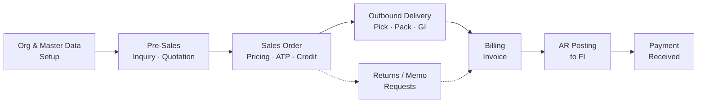

---

## 2. Level 1 — End-to-end O2C swimlane (happy path plus the main exceptions)

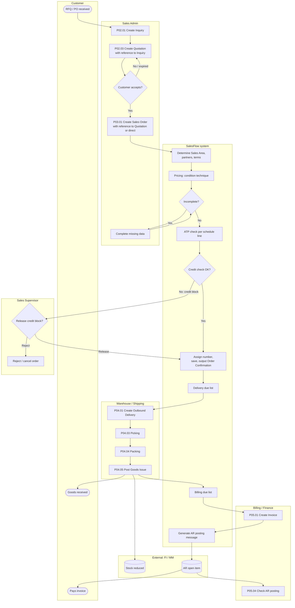

**Exceptions shown elsewhere:** insufficient stock (§4), credit block release (§5), billing cancellation (§7), returns (§8), credit/debit memo (§9).

---

## 3. P02 — Pre-sales: Inquiry → Quotation

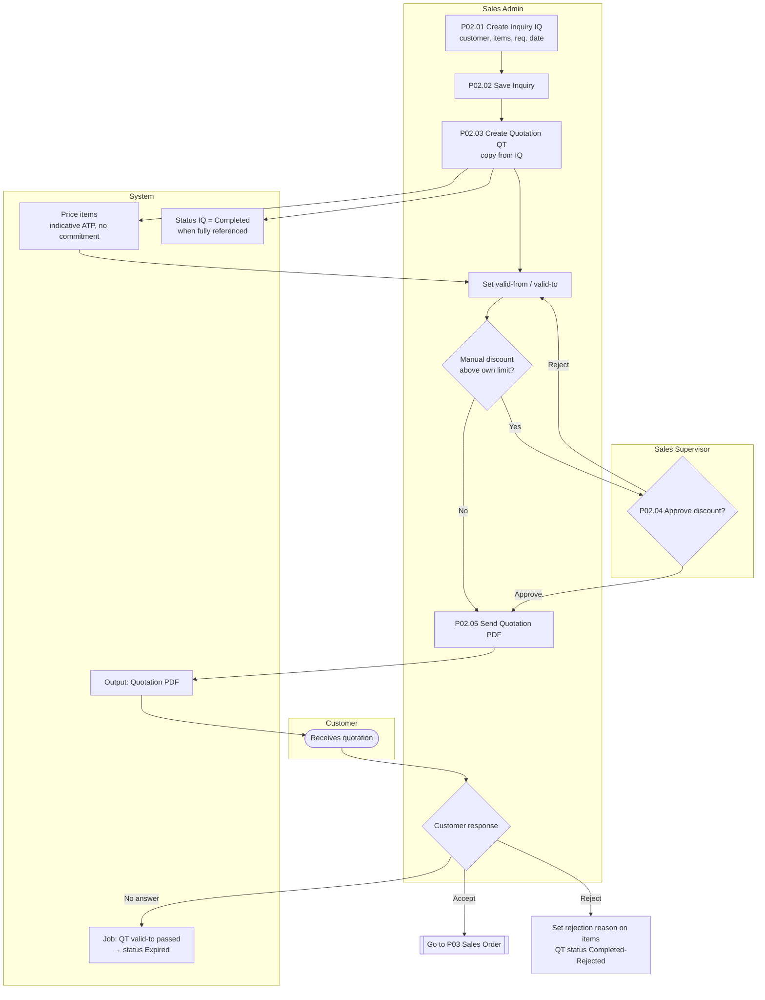

| Step | Role | Activity | Rule / control (BR-xx defined in BRD) |
|---|---|---|---|
| P02.01 | SA | Create inquiry for a Sold-to in an authorised Sales Area | Sales Area must be valid for the customer |
| P02.03 | SA | Create quotation **with reference** (copy rule IQ→QT) or without reference | Copy rule decides which fields are copied |
| P02.04 | SV | Approve a discount above the Sales Admin limit (Q-08 / Q-13) | Approval is written to the audit trail |
| P02.05 | SA | Send the quotation | Output template QT-PDF |
| — | SYS | Quotation expiry job (D-10) | Expired QT can't be referenced |

---

## 4. P03 — Sales Order: create, price, ATP, credit, save

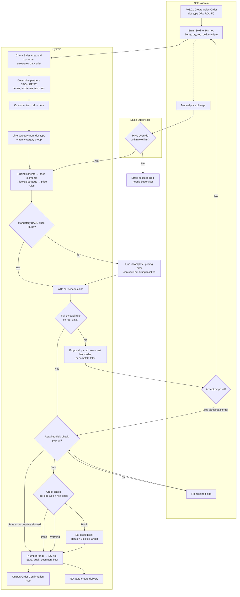

| Step | Role | Activity | Key controls |
|---|---|---|---|
| P03.01 | SA | Pick the document type. The Sales Area is limited to the user's authorisation scope | RBAC on Sales Area |
| P03.02 | SYS | Partner determination from customer master | Ship-to, Bill-to and Payer must be valid for the Sales Area |
| P03.03 | SYS | Line category determination: DocType + ItemCatGroup (+ usage, + higher-level line category) | Configured in the line category assignment table |
| P03.04 | SYS | Pricing (scales, validity on pricing date) | A missing BASE price marks the line incomplete |
| P03.05 | SYS | ATP: confirm qty per schedule line; offer partial/complete | Respects customer partial-delivery flag (Q-09) |
| P03.06 | SYS | Required-field check per Doc type / Line category / Schedule line category | The document can be saved incomplete, but **not delivered or billed** (configurable per field) |
| P03.07 | SYS | Credit check (static/dynamic) | Block → no delivery until released |
| P03.08 | SYS | Number assignment, document flow record, audit, Order Confirmation output | Number range per Company + DocType + Year |
| P03.09 | SA/SV | Change order (qty, date, price, rejection reason) | Changing qty or date runs ATP again. Increasing value runs the credit check again |

---

## 5. P03.10 — Credit block release & blocked-order worklist

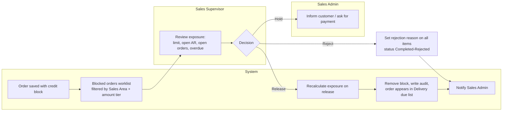

Re-check points: credit is re-checked at **order change (value increase)**, at **delivery creation** and at **GI** (configurable per Doc type, A-21). A release is valid for a set number of days or until the value goes up by more than the configured %.

---

## 6. P04 — Outbound Delivery → Picking → Packing → Goods Issue

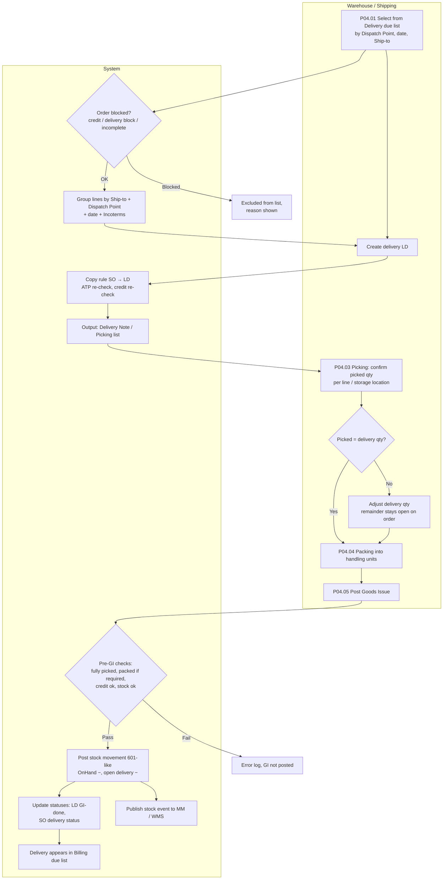

| Step | Role | Activity | Key controls |
|---|---|---|---|
| P04.01 | WH | Create a delivery one by one or from the due list (collective) | Only lines with confirmed qty and no blocks |
| P04.02 | SYS | Dispatch Point determination (Site + shipping condition + loading group) | Configured table |
| P04.03 | WH | Picking confirmation | Picked qty ≤ delivery qty. Under-pick reduces the delivery (open qty returns to the order) |
| P04.04 | WH | Packing (optional per Delivery type) | All lines packed if "packing required" |
| P04.05 | WH | Post Goods Issue | Stock can't go negative (configurable). GI can be reversed until the delivery is billed |
| P04.06 | WH | Reverse GI | Only if not billed. Stock goes back. Status moves back to "Picked" |

---

## 7. P05 — Billing → AR posting → Cancellation

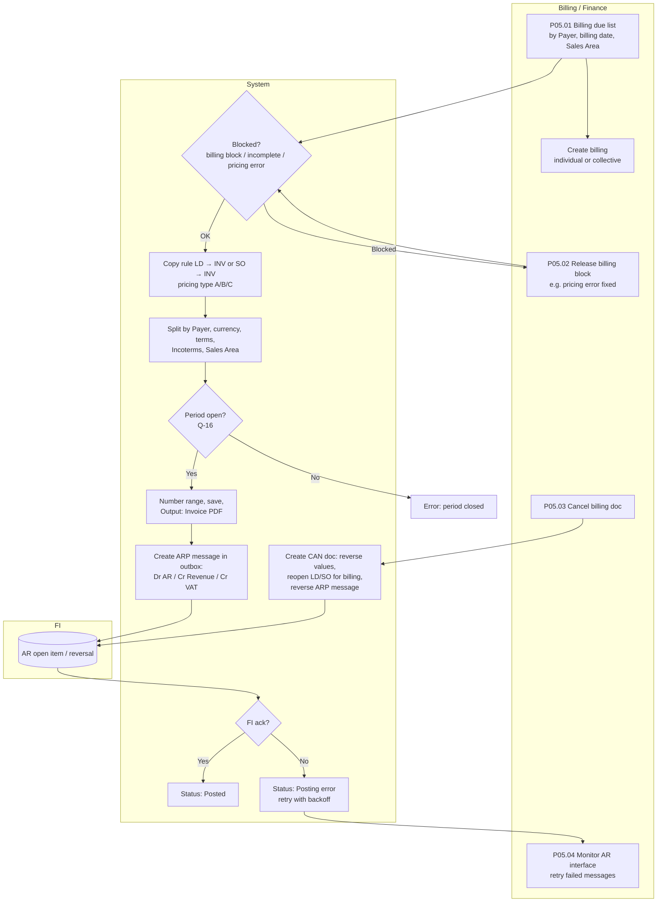

---

## 8. P06 — Returns: Returns Order → Return Delivery → Goods Receipt → Credit Note

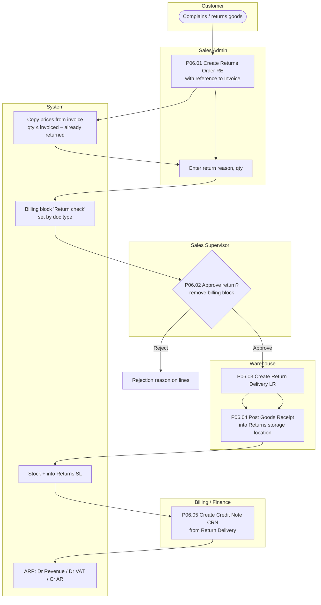

---

## 9. P07 — Credit Note Request / Debit Note Request (price corrections, no goods movement)

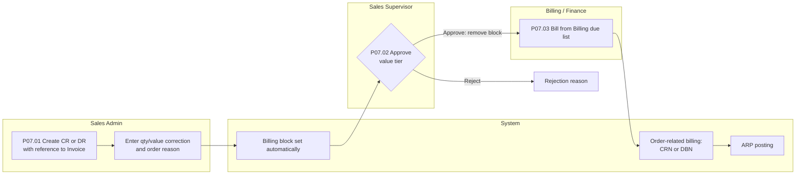

---

## 10. P01 — Master data & configuration (Admin lane)

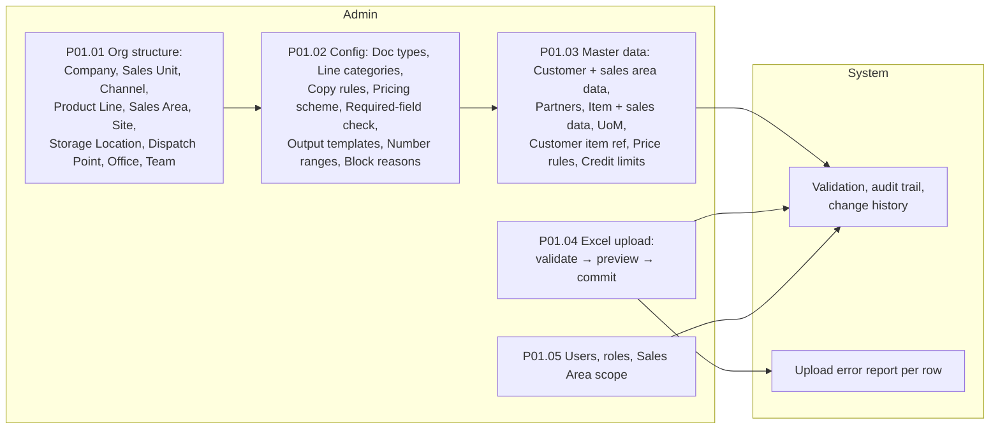

Order of dependency: **Org structure → Configuration → Master data → Transactions.** Phase 1 of the build covers this lane and can be tested on its own.

---

## 11. Document flow (reference chain) and copy rules (preview)

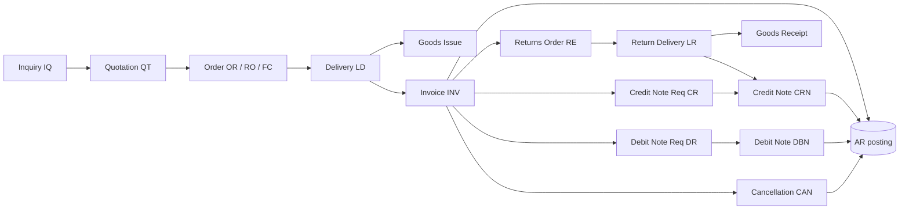

| From \ To | QT | OR/RO | FC | RE | CR | DR | LD | LR | INV | CRN | DBN | CAN |
|---|---|---|---|---|---|---|---|---|---|---|---|---|
| IQ | ✔ | ✔ | | | | | | | | | | |
| QT | | ✔ | ✔ | | | | | | | | | |
| OR / RO | | ✔ (copy) | | | | | ✔ | | ✔ order-related lines only | | | |
| FC | | | | | | | ✔ | | — (no billing) | | | |
| RE | | | | | | | | ✔ | | ✔ order-related option | | |
| CR / DR | | | | | | | | | | ✔ (CR) | ✔ (DR) | |
| LD | | | | | | | | | ✔ | | | |
| LR | | | | | | | | | | ✔ | | |
| INV | | | | ✔ | ✔ | ✔ | | | | | | ✔ |
| CRN / DBN | | | | | | | | | | | | ✔ |

Every flow record stores: preceding doc/line, subsequent doc/line, quantity and value referenced, and the copy rule used. Status of the preceding document = f(referenced qty vs. original qty).

---

## 12. Status model overview (detailed state machines in FSD)

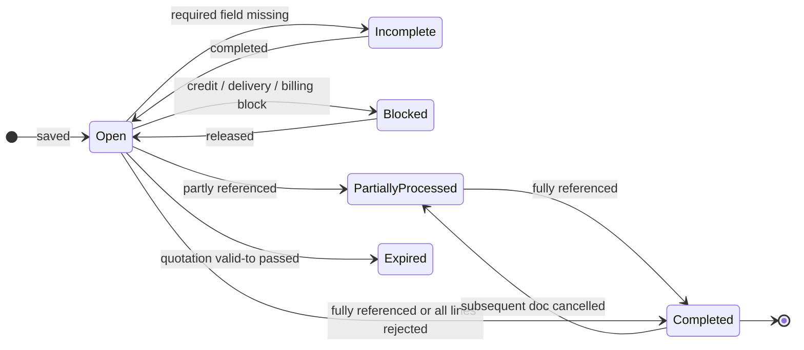

Status **dimensions** are kept as separate columns. For example, a Sales Order header carries: `OverallStatus`, `DeliveryStatus`, `BillingStatus`, `CreditStatus`, `IncompletionStatus` and `BlockStatus`. Each dimension uses the values `NotRelevant / NotProcessed / Partial / Complete`. `OverallStatus` is calculated from them (deviation D-09).

---

## 13. RACI (R = responsible, A = accountable, C = consulted, I = informed)

| Activity | SA | SV | WH | BF | AD | SYS |
|---|---|---|---|---|---|---|
| Maintain org structure & configuration | I | C | I | C | **A/R** | — |
| Maintain customer / item / price master | R | A | I | C | C | validates |
| Credit limit maintenance | I | C | | **A/R** | | validates |
| Inquiry / Quotation | **R** | A | | | | prices |
| Discount above limit approval | R | **A** | | | | enforces |
| Sales Order entry & change | **R** | A | I | | | ATP / price / credit |
| Credit block release | I | **A/R** | I | C | | re-checks |
| Delivery creation, picking, packing, GI | I | | **A/R** | I | | stock posting |
| Billing, cancellation | I | | | **A/R** | | AR message |
| Returns order & approval | R | **A** | R (GR) | R (CRN) | | |
| Credit / debit note request | R | **A** | | R | | |
| AR interface monitoring | | | | **A/R** | C | retries |
| Users & roles | | C | | | **A/R** | audits |

---

## 14. Traceability seed (used by BRD / FSD / UAT)

| Process | Flow ID | Source phase |
|---|---|---|
| Master data & config | P01 | Phase 1 |
| Pre-sales | P02 | Phase 2 |
| Sales order, pricing, ATP, credit | P03 | Phase 2 |
| Delivery, pick, pack, GI | P04 | Phase 3 |
| Billing, cancellation, AR interface | P05 | Phase 4 |
| Returns | P06 | Phases 3–4 |
| Credit / debit memo | P07 | Phase 4 |
| Reports & worklists | P08 (due lists, backlog, doc flow, analysis) | Phase 5 |

---

**Approval requested:** please confirm or correct the flows above and answer the open questions in `00-assumptions-and-open-questions.md` §3 (or accept the defaults). After approval, Deliverable 2 (BRD summary with the BR-xx list) follows.
